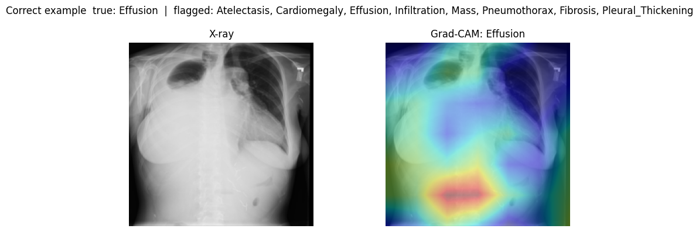
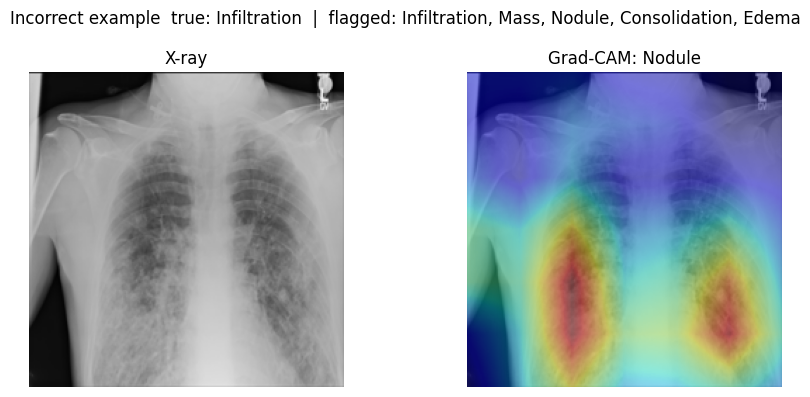
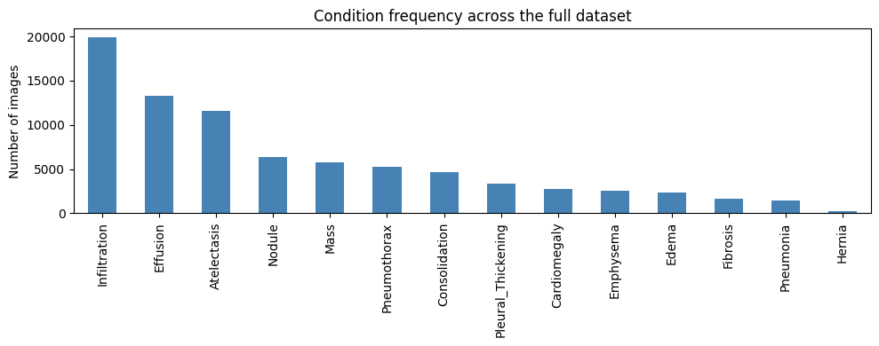
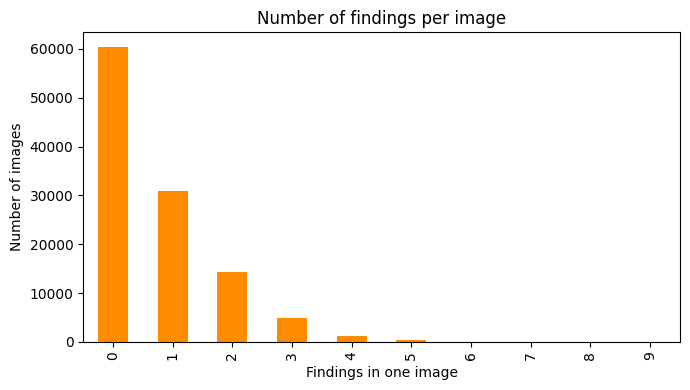
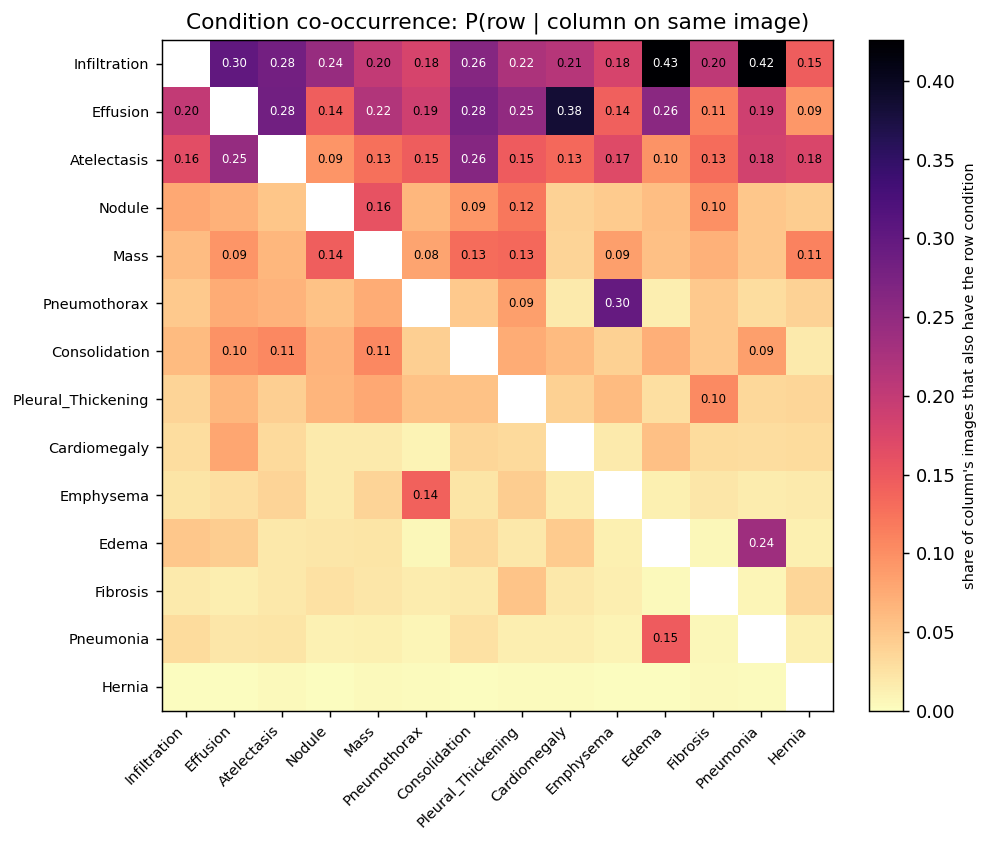
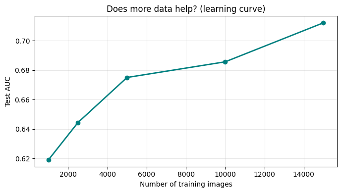

# Chest X-ray Multi-Label Classifier

A team class project from the M.S. Business Analytics program at the University of Louisville.
Predict 14 thoracic conditions from a chest X-ray using the public **NIH ChestX-ray14**
dataset. This package is self-contained: it downloads its own data, trains the models, and
ships a working web app. You can either just *read the results* or *run it yourself*.

[](https://colab.research.google.com/github/SpencerGoss/chest-xray-classifier/blob/main/chest_xray_portable_pipeline.ipynb)

### Quickest way to try it (any device, no install, no training)
Click the **Open in Colab** badge above. Then run the first setup cells and the section titled
**"Try it now: classify an X-ray (no training needed)."** It downloads the already-trained model
(~20 MB, once) and classifies chest X-rays right in the notebook, with the Grad-CAM heat map. You do
not need your own laptop, a GPU, or to retrain anything.

<table>
<tr>
<td width="50%"><br><sub><b>Where the model looked (correct).</b> True finding: effusion. The heat map sits low in the chest, where fluid collects.</sub></td>
<td width="50%"><br><sub><b>Where it went wrong.</b> True finding: infiltration. The model also flagged nodule and mass, and the heat map shows why: it spread across both lungs.</sub></td>
</tr>
</table>

## Results at a glance

Eight models were trained on the same image features and scored on a held-out test set. **Macro AUC** (the
average across all 14 conditions) is the headline number, because plain accuracy is misleading here: an average
image is negative for 13.28 of the 14 conditions, so a model that always says "nothing found" looks accurate.

| Model | Test macro AUC |
|---|---|
| **Neural network (512-256-14)** | **0.729** |
| Neural network, deeper (512-256-128-14) | 0.725 |
| Random forest | 0.703 |
| Naive Bayes | 0.686 |

- **Tuned thresholds.** Setting a separate decision threshold per condition (chosen on the validation set to
  favor catching disease) raised macro recall from 0.543 to 0.577.
- **Patient-level check.** The same patient can appear in many images. Re-splitting so no patient is in both
  train and test gives 0.670 AUC, the more realistic number.
- **More data helps.** Test AUC climbed from 0.619 with 1,000 training images to 0.712 with 15,000.

<table>
<tr>
<td width="50%"><br><sub><b>Heavy class imbalance.</b> Infiltration appears in about 20,000 images; hernia in a few hundred.</sub></td>
<td width="50%"><br><sub><b>Most images have no finding,</b> which is why accuracy alone is the wrong metric.</sub></td>
</tr>
<tr>
<td width="50%"><br><sub><b>Conditions overlap.</b> Edema shows up with pneumonia, effusion with cardiomegaly, so this is a multi-label problem.</sub></td>
<td width="50%"><br><sub><b>Learning curve.</b> Test AUC kept rising with more training images, so more data is the clearest next step.</sub></td>
</tr>
</table>

## What's in this folder

| File / folder | What it is |
|---|---|
| `chest_xray_portable_pipeline.ipynb` | The whole project in one notebook, **with all charts, tables, and Grad-CAM images already saved inside.** Open it and read top to bottom; no need to run anything. |
| `cxr_app/` | The trained model + a ready-to-run **Streamlit web app** (`app.py`). |
| `build_portable_notebook.py` | The generator script that produced the notebook (for regenerating/tweaking). You don't need this to use the project. |

## Three ways to use it

### 1. Just read it (zero setup)
Open `chest_xray_portable_pipeline.ipynb` in Jupyter, VS Code, or on GitHub. Every output is
already baked in, so you see the full analysis, the model comparison, and the Grad-CAM
explanations without running a single cell.

### 2. Run the notebook yourself
- **Google Colab (easiest):** upload the notebook → *Runtime → Run all*. It installs what it
  needs and downloads the data automatically.
- **Locally:** open in Jupyter/VS Code and *Run All*.
- Downloads ~8 MB of labels + ~9 GB of images (once, then cached). Takes ~30 to 60 min.
- To do a quick test instead of the full run, set the environment variable
  `CXR_SAMPLE_SIZE=1000` (and `CXR_N_ARCHIVES=1`) before running.

### 3. Run the web app

**Easiest (Windows): double-click `run_app.bat`.** It automatically finds a compatible Python
(3.10 to 3.12), sets up everything the first time, and opens the app in your browser. Leave the black
window open while you use the app; close it to stop. The first run takes a few minutes (it downloads
TensorFlow); after that it starts in seconds.

**Manual way (any OS):**
```
pip install -r cxr_app/requirements.txt
streamlit run cxr_app/app.py
```

> **Important:** the app uses TensorFlow, which only supports **Python 3.10 to 3.12** (not 3.13+). If you
> run it on a newer Python the install fails and nothing opens at localhost. `run_app.bat` handles this
> for you; for the manual way, use a 3.10 to 3.12 interpreter (e.g. `py -3.12 -m venv .venv` first).

A browser tab opens at `http://localhost:8501` (give it ~15 to 20 seconds the first time while the model
loads). It has two modes (sidebar):

- **Classify**: upload a chest X-ray (or pick a bundled sample) and see the predicted
  conditions, which ones it flags, a Grad-CAM heat map of where the model looked, and a
  "looks right / looks off" feedback button.
- **Monitoring**: a population-level dashboard built from the prediction log the app writes
  on every classification (`cxr_app/logs/predictions_log.csv`): how often each condition is
  flagged, the confidence spread, recent cases, and the feedback tally. The same CSV could
  feed Power BI or Google Sheets.

## What the project actually does

1. **Explores** the dataset and shows *why plain accuracy is misleading* on it (most images are
   negative for most conditions), including a condition co-occurrence heat map (the 14 labels
   overlap) and a look at who's in the data (age and sex).
2. **Transfer learning:** a frozen, ImageNet-pretrained EfficientNetB0 turns each X-ray into 1,280
   features (using the model's own `preprocess_input` + `StandardScaler`, as taught in class), with a
   quick PCA look at those features.
3. **Tries many models** on the same features and shows the results, baseline, logistic regression,
   naive Bayes, k-NN, random forest, gradient boosting, and two neural nets (shallow vs deeper), 
   scored mainly by **macro AUC** (the honest headline metric) and sorted so the winner is obvious.
4. **Tunes the winning neural network** with a per-condition decision threshold (chosen to favour
   *recall*, catching disease, using the validation set only).
5. **Explains predictions** with Grad-CAM and **saves the model**.
6. **Generates the Streamlit app** that wraps that model (upload an X-ray → predictions + heatmap,
   and for bundled samples, expected-vs-predicted), with prediction logging, a feedback button, and a
   **Monitoring** dashboard for the population-level view.

## Important note

This is an **educational project, not a medical device.** It uses a sample of the data and a
frozen backbone, so it's a lightweight illustration of the published CheXNet approach (per-condition
AUC ≈ 0.7 to 0.85), not a clinical tool. Never use it for real diagnosis.

> **The one metric lesson:** always report accuracy *with* the number of training images and
> *alongside* AUC, never on its own.

## Requirements

Python 3.10 to 3.12 (TensorFlow does not yet support 3.13+). Packages: `tensorflow`, `scikit-learn`,
`pillow`, `scipy`, `pandas`, `matplotlib`, and `streamlit` (for the app). The notebook installs
these for you; the app needs them installed in whatever environment you run it from.
